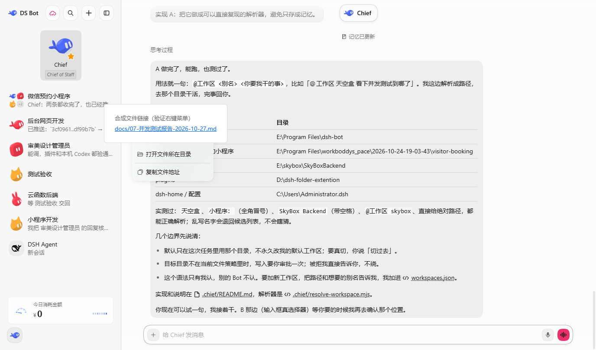

# dsh-file-link-menu

在 DSH（DeepSeek Harness）Web 聊天里**右键文件链接**，弹出与 DSH 同风格的菜单：

| 菜单项 | 行为 |
|---|---|
| 打开文件 | 用系统默认程序打开该文件（桌面宿主不可用时自动隐藏此项） |
| 打开文件所在目录 | 在资源管理器 / Finder 中定位该文件 |
| 复制文件地址 | 把文件的**绝对路径**复制到剪贴板（成功后顶部 toast 提示） |



支持的链接形态（都是 DSH 自己渲染出来的文件链接）：

- Markdown 文件链接，例如 `[报告](docs/07-并发测试报告.md)`
- 消息里的行内产物引用，例如 `docs/07-并发测试报告.md`、`tools/concurrency-test.js`
- 图片文件链接（有缩略图预览的那种）
- “已编辑 N 个文件”卡片里的文件行
- 交付物（presented）卡片

## 实现要点

- 纯客户端插件：`lib/client.js` 通过 `window.__ModuleLoader__.load` 注册，向 `shell.overlay` 槽位挂一个全局右键菜单宿主。
- 菜单外观、键盘操作（↑/↓/Home/End/Esc/Enter）、点击外部关闭都复用 `@deepseek-ai/dsh-client-ui-primitives` 的 `Menu` / `Toast`，因此和 DSH 原生菜单完全一致。
- 打开 / 定位走宿主 Remote `session.openWorkspacePath({ path, action? })`（与官方“打开 / 显示文件位置”同一套 API）；相对路径会用当前会话的 `cwd` 补成绝对路径。
- 复制地址用 primitives 的 `writeClipboard`（优先 Clipboard API，失败回退 execCommand）。
- 宿主半侧 `lib/index.js` 是空插件：本功能不需要宿主代码，条目存在只为把包纳入 Loader 组合。

## 安装

### 方式一：DSH Desktop 插件页（推荐，可热生效）

1. 打开 DSH Desktop → 设置 → 插件（Plugins）。
2. 安装本地插件，路径填本仓库的绝对路径，例如：

   ```
   E:\project\dsh-file-link-menu
   ```

3. 安装完成后插件会出现在当前 profile 的 bundle 列表并立即生效（返回 `applied` 时无需重启；页面刷新一次更稳）。

> 本地目录以符号链接方式安装（`node_modules/dsh-file-link-menu -> E:\project\dsh-file-link-menu`），
> 因此改完源码刷新页面即可；若改了 `package.json` 的 `dsh` 声明，重新安装/重启应用一次。

### 方式二：命令行（web 等可自管 profile）

```sh
dsh plugin --profile web add "E:\project\dsh-file-link-menu"
dsh --profile web --dump-config | grep file-link-menu   # 只读校验
```

> Desktop profile 由 Electron 独占管理，`dsh plugin --profile desktop` 会被拒绝；桌面端请用方式一或直接管理插件页。

## 启用 / 停用

- 停用：从 profile 的 `dsh.profile.bundles` 移除，或在 `cordis.patch.yml` 写入
  `- id: file-link-menu\n  disabled: true` 后重启 / 重新加载。
- 本插件不修改任何 DSH 原生行为，只监听文件链接上的 `contextmenu`；普通文本、外链右键仍是浏览器/DSH 原生菜单。

## 测试

检测逻辑（链接识别、路径拼接、行号锚点、图片链接、卡片行）带离线单元测试：

```sh
node test/detect.test.mjs
```

## 兼容性

- 目标：DSH `0.2.1-rc.3` Desktop（`shell.overlay` 槽位 + `session.openWorkspacePath` Remote）。
- 无第三方依赖；只 `require` 平台种子模块 `react` 与 `@deepseek-ai/dsh-client-ui-primitives`。

## 文件结构

```
dsh-file-link-menu/
├── package.json          # dsh.bundle.patch + dsh.client(platform web)
├── cordis.patch.yml      # 把自己插入 profile Loader 组合
├── lib/
│   ├── index.js          # 宿主半侧（空插件）
│   └── client.js         # 浏览器半侧：右键菜单 + 宿主动作
├── test/detect.test.mjs  # 离线单元测试
├── docs/menu.png         # 实测截图
├── LICENSE
└── README.md
```

## License

MIT
